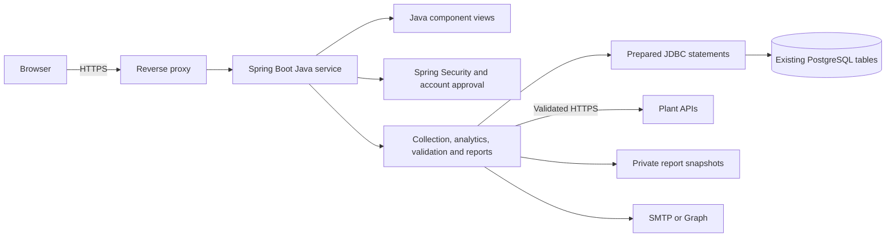

# WEBGSO Java architecture

Java hosts pages and authenticated APIs together. Forms use sessions and CSRF. Approval, security stamps and roles are rechecked on authenticated requests; sessions expire after 15 idle minutes. Credentials stay on the server.

`Models` and `Tables` map the former EF Core records to exact PostgreSQL names. `Store` binds values and allowlists record identifiers. Forecast timestamps use `LocalDateTime`; lifecycle instants use `OffsetDateTime`. Schema creation is disabled unless explicitly requested for an empty database.

`CollectionService` claims work under a plant-row transaction, fetches outside that transaction, retains raw responses, and atomically publishes readings, anomalies and completion. A failed parse preserves its response and records failure without publishing partial readings. `ManualBatchService` uses six workers and a bounded queue. Batch status is requester-scoped; completed jobs remain in database history.

`PlantApiClient` checks DNS destinations when connecting, preserves TLS validation, rejects redirects, caps payload bytes and requires explicit private/HTTP exceptions. `PayloadTranslator` supports JSON records/columnar/matrix data, XML/SOAP without external entities, and quoted CSV. MMF sensors are averaged; the collection command owns submission time.

`ReadingService` selects the latest readings per plant, parameter and data timestamp. `AnalyticsService` aggregates states/regions. Reports validate stored values and apply previous-day, capacity or zero substitutions without overwriting source readings. Apache POI creates Excel workbooks; CSV exports neutralize formula fields. Downloads check ownership and keep snapshots outside public assets. Legacy reports can be regenerated from stored selections.

`ScheduledWorkers` implements collection, reporting and notification processing and is disabled during cutover by default. Delivery statuses reflect actual email outcomes. Synthetic API endpoints are registered only in local/demo profiles. The original implementation remains in Git at `606bf85`; Java has no .NET runtime dependency.
