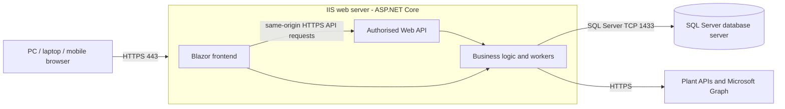

# SBLSS system architecture

The application server and database server are separate. The Blazor web
application and its authorised Web API run together on the web server. Only the
web server connects to SQL Server; browsers never connect to SQL directly.

## Request flow

1. A user signs in through the HTTPS web address.
2. The Blazor frontend sends same-origin HTTPS requests to the authorised API.
3. The API validates the user's session and role, then runs application logic.
4. Entity Framework Core connects from the web server to SQL Server over TCP
   1433 and returns only the requested data through the API.
5. The browser renders the API response. It has no database credentials or SQL
   route.

The API is hosted by the same ASP.NET Core application as Blazor. It is a
separate application layer, not a second public server or process. This matches
the pictured IIS web server containing both the frontend and backend API.

## Network and server requirements

- Bind the IIS site to HTTPS on port 443 with a certificate for the production
  DNS name. The current local team profile uses port 8088 and its existing
  `sblss-lan.local` certificate.
- Permit inbound HTTPS from authorised user networks to the web server.
- Permit inbound SQL TCP 1433 on the database server only from the web server's
  address. Do not expose SQL Server to user networks or the public internet.
- Give the IIS application identity a least-privilege SQL login for the SBLSS
  database. Keep credentials and Entra secrets outside the repository.
- Allow the web server outbound HTTPS only to approved plant API and identity
  endpoints required by the deployment.
- Back up the database independently and test restoring it to the disaster
  recovery server.

## Current host and VMware profile

The working local profile runs the web application on the Windows host and SQL
Server in the VMware VM at `192.168.227.128:1433`. Its database is
`SingleBuyerLssRepository`. `run-sblss-system.cmd` starts the host application
with the existing VM connection and LAN HTTPS address. This profile uses the
same web-to-database boundary for development, while IIS and a production DNS
name are deployment steps for the dedicated web server.

## API and database boundaries

The secured HTTP endpoints include:

- `GET /api/dashboard` for repository overview data.
- `GET /api/status` for database connectivity and operational counts.
- `GET /health` for service health.
- `GET /api/ping` for an authorised application connectivity check.

All SQL access stays in backend connectors, business services, workers and
infrastructure code. Razor frontend files do not use Entity Framework or SQL.

## Simplified file map

| Function | Razor frontend | C# logic or connector | Database |
| --- | --- | --- | --- |
| Login | `Login.razor` | `Login.cs`, `LoginConnector.cs` | Identity tables |
| Dashboard | `Dashboard.razor` | `Dashboard.cs`, `RepositoryBackendApi.cs` | Repository tables |
| DDQ and MMF analytics | `DdqAnalytics.razor`, `MmfAnalytics.razor` | `AnalyticsConnector.cs` | Operational data |
| Collection management | `CollectionManagement.razor` | `PlantApiConnector.cs`, `CollectionCqrs.cs` | Jobs and API responses |
| Plant configuration | `LssPlants.razor` | `PlantApiConnector.cs` | Plants and API configuration |
| Collection schedules | `CollectionSchedules.razor` | Collection services | Schedules and jobs |
| Report automation | Report pages | Report services and workers | Reports and deliveries |
| User access | `StaffAccounts.razor` | ASP.NET Core Identity | Identity tables |
| Audit and data quality | `AuditLogs.razor`, `DataQuality.razor` | Audit and validation services | Audit and anomaly tables |

`DatabaseConnection.cs` maps C# entities to SQL Server. `CreateTables.cs`
creates and upgrades the development schema. Operational records use relational
SQL tables.
