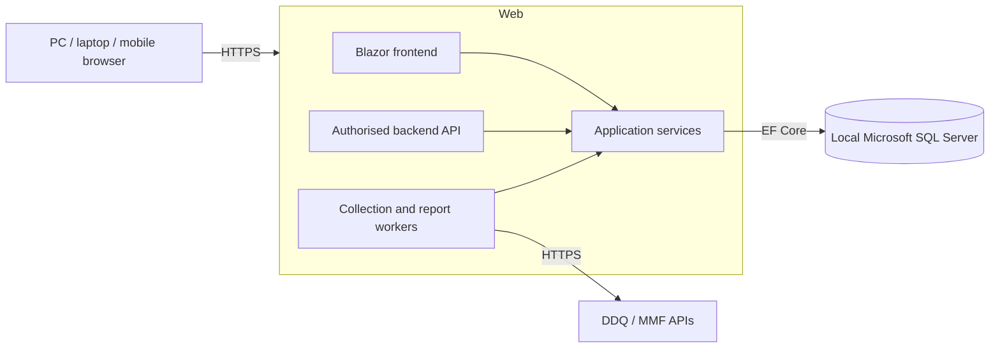

# SBLSS application architecture

The local system uses one ASP.NET Core host for the Blazor frontend and secured
Web API. Microsoft SQL Server remains on the same machine during development.
There is no firewall or remote database-server dependency in this profile.

## Request flow

1. A user signs in with the configured Microsoft identity provider over HTTPS.
2. Blazor handles the user interaction and passes it to backend page logic or an
   authorised HTTP API endpoint in the same ASP.NET Core host.
3. The backend validates authorization and runs the business operation.
4. Only backend services, workers and infrastructure connectors use EF Core to
   access the local SQL Server database.
5. The backend returns a typed response for Blazor to render.

The secured HTTP endpoints currently include:

- `GET /api/dashboard` for the repository overview.
- `GET /api/status` for database and operational counts.
- `GET /health` for a minimal service-health result.
- `GET /api/ping` for an application connectivity check.

Interactive Blazor Server components and HTTP endpoints reuse the same typed
backend services inside the web host. A server-rendered Blazor action enters the
backend in-process instead of making a wasteful HTTP request back to the same
server. Browser-side reads use the authorised `/api` endpoints where appropriate.
All frontend `.razor` files remain free from Entity Framework and SQL access.

## Simplified file map

Filenames use descriptive names without FSD numbers.

All application records are stored in relational Microsoft SQL Server tables. `DummyApiDataSeeder.cs` creates one connected development dataset for plants, API configurations, collections, readings, schedules, anomalies, reports, recipients and deliveries.

| Function | Razor frontend | C# logic | Connector | Database table |
| --- | --- | --- | --- | --- |
| Login | `Login.razor` | `Login.cs` | `LoginConnector.cs` | `UserTable.cs` |
| Dashboard | `Dashboard.razor` | `Dashboard.cs` | `RepositoryBackendApi.cs` | `DashboardDocumentTable.cs` |
| DDQ analytics | `DdqAnalytics.razor` | `DdqAnalytics.cs` | `AnalyticsConnector.cs` | Stored operational data |
| MMF analytics | `MmfAnalytics.razor` | `MmfAnalytics.cs` | `AnalyticsConnector.cs` | Stored operational data |
| On-demand reports | `OnDemandReport.razor` | `OnDemandReport.cs` | EF Core | `ReportExecutions` |
| Report history | `ReportHistory.razor` | `ReportHistory.cs` | EF Core | `ReportExecutions` |
| Collection management | `CollectionManagement.razor` | `CollectionManagement.cs` | `PlantApiConnector.cs` | `CollectionJobs`, `RawApiResponses` |
| Staff accounts | `StaffAccounts.razor` | `StaffAccounts.cs` | ASP.NET Core Identity | `UserTable.cs` |
| LSS plants | `LssPlants.razor` | `LssPlants.cs` | `PlantApiConnector.cs` | `LssPlantTable.cs` |
| Collection schedules | `CollectionSchedules.razor` | `CollectionSchedules.cs` | EF Core | `CollectionSchedules` |
| Scheduled reports | `ScheduledReports.razor` | `ScheduledReports.cs` | EF Core | `ReportSchedules`, `ReportScheduleRecipients`, `ReportDeliveryAttempts`, `ReportDeliveryRecipients` |
| Data quality | `DataQuality.razor` | `DataQuality.cs` | `ExternalConnectors.cs` | `OperationalTables.cs` |
| Audit logs | `AuditLogs.razor` | `AuditLogs.cs` | `AuditConnector.cs` | `AuditEventTable.cs` |

## Required framework files

`Program.cs`, `App.razor`, `Routes.razor`, `_Imports.razor`, layouts, the project file and application settings remain separate because ASP.NET Core and Blazor require them.

## Database files

- `DatabaseConnection.cs` maps C# entities to SQL Server.
- `CreateTables.cs` creates and upgrades development tables.
- `DatabaseSettings.cs` represents database configuration.
- Operational relationships use foreign keys; generic JSON storage is no longer used.
